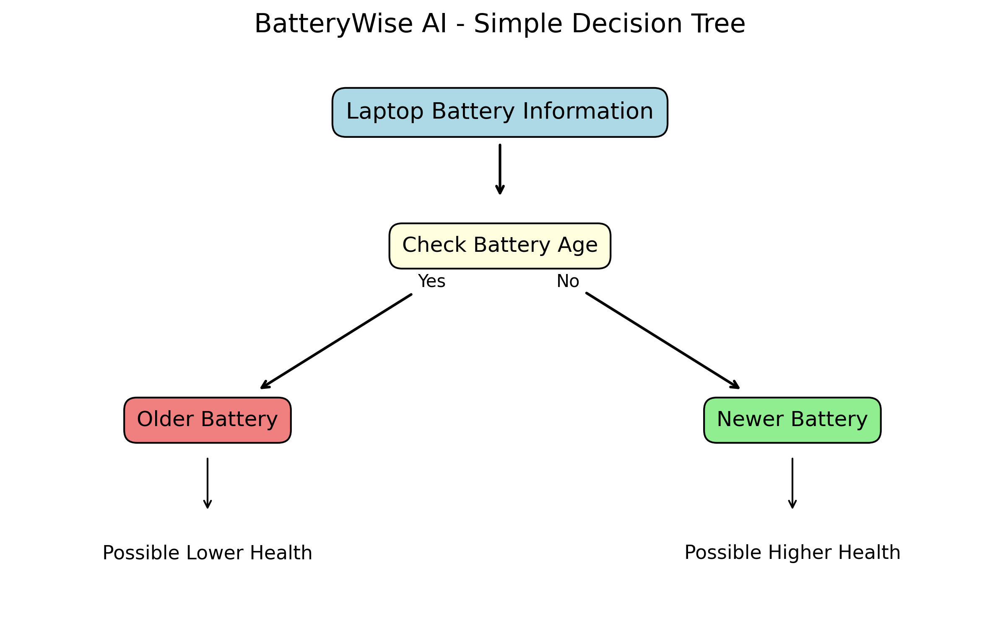

# 🔋 BatteryWise AI – Laptop Battery Health Classifier

<p align="center">
  <strong>An Interactive Machine Learning-Based Laptop Battery Health Analysis Platform</strong>
</p>

<p align="center">
  
  
  
  
  
</p>

---

## 📌 Project Overview

BatteryWise AI is a Machine Learning-powered web application designed to classify laptop battery health based on battery usage patterns, charging cycles, battery age and laptop specifications.

The application uses a **Decision Tree Classifier** to predict battery health categories and provides an interactive dashboard for exploring battery statistics, generating predictions and understanding battery-care practices.

The goal is to demonstrate how Machine Learning and data visualization can be used to analyze laptop battery health patterns.

## ✨ Key Features

- Interactive battery health dashboard.
- Machine Learning-based battery health classification.
- Laptop battery diagnostics using user inputs.
- Interactive charts and visualizations using Plotly.
- Battery age and charging-cycle analysis.
- Laptop brand and usage comparisons.
- Battery-care recommendations.
- Downloadable prediction reports in CSV format.
- Decision Tree model information and dataset exploration.

---

## 🖥️ Application Screenshots

### 1. Main Dashboard


### 2. Battery Health Prediction


### 3. Interactive Analytics


### 4. Decision Tree Visualization



*Note: The decision tree image is a simplified explanatory illustration, not the exact trained model tree.*

---

## 🧠 Machine Learning Model

**Algorithm:** Decision Tree Classifier

The model uses laptop specifications and battery usage information to classify battery health into three categories.

### Battery Health Categories

| Category | Battery Health |
|---|---|
| High | ≥ 80% |
| Moderate | 60% to below 80% |
| Low | Below 60% |

These thresholds are project-defined for classification purposes and are not official industry standards.

### Input Features

The model uses the following features:

1. Laptop brand
2. Model year
3. Operating system
4. Usage type
5. Daily usage hours
6. Charging cycles
7. Average charge limit percentage
8. Battery age in months
9. Overheating issues
10. Performance rating

### Model Workflow

1. Load the battery dataset.
2. Inspect and preprocess the data.
3. Create battery health categories.
4. Convert categorical variables using One-Hot Encoding.
5. Split the dataset into training and testing sets.
6. Train the Decision Tree Classifier.
7. Generate predictions.
8. Evaluate the model and save the trained model.

---

## 📊 Dataset Information

The project uses a sample dataset containing **50 laptop records**.

The dataset includes:

- Laptop brand and model year.
- Operating system and usage type.
- Daily usage hours.
- Charging cycles.
- Battery age.
- Average charging limit.
- Overheating issues.
- Battery health percentage.
- Performance rating.

The battery health percentage is used to create the classification target.

---

## 🛠️ Technologies Used

| Technology | Purpose |
|---|---|
| Python | Core programming language |
| Pandas | Data manipulation |
| NumPy | Numerical operations |
| Scikit-learn | Machine Learning |
| Streamlit | Web application |
| Plotly | Interactive visualizations |
| Matplotlib | Data visualization |
| Seaborn | Statistical visualization |
| Joblib | Model serialization |
| Jupyter Notebook | Model development |

---

## 📁 Project Structure

```text
BatteryWise-AI/
│
├── app.py
├── app_backup.py
├── batterywise.ipynb
├── battery_data.csv
├── batterywise_model.pkl
├── feature_columns.pkl
├── simple_decision_tree.png
├── dashboard.png
├── prediction.png
├── analytics.png
├── requirements.txt
├── README.md
└── .gitignore
```

---

## ⚙️ Installation and Setup

### 1. Clone the repository

```bash
git clone https://github.com/yashnerkar7/BatteryWise-AI.git
```

### 2. Navigate to the project directory

```bash
cd BatteryWise-AI
```

### 3. Create a virtual environment

```bash
python -m venv venv
```

### 4. Activate the virtual environment

**Windows:**

```bash
venv\Scripts\activate
```

### 5. Install dependencies

```bash
pip install -r requirements.txt
```

### 6. Run the application

```bash
streamlit run app.py
```

The application will open in your default web browser.

---

## 📈 Model Limitations

- The dataset contains only 50 records.
- The Low battery health category has very few examples.
- Predictions depend on the patterns present in the training dataset.
- Model probabilities are not calibrated certainty estimates.
- The application does not directly measure actual laptop battery capacity.
- Results should not be treated as professional battery diagnostics.

This project is intended for educational and demonstration purposes.

---

## 🔮 Future Improvements

- Expand the dataset with more diverse laptop records.
- Compare multiple Machine Learning algorithms.
- Improve model validation and class balance.
- Integrate actual battery health reports from operating systems.
- Introduce battery degradation trend estimation.
- Improve prediction explanations.
- Deploy the application online.

---

## 👨‍💻 Author

**Yash Nerkar**

GitHub: [@yashnerkar7](https://github.com/yashnerkar7)

Project Repository: [BatteryWise AI](https://github.com/yashnerkar7/BatteryWise-AI)

---

<p align="center">
  ⭐ If you find this project interesting, consider giving the repository a star!
</p>